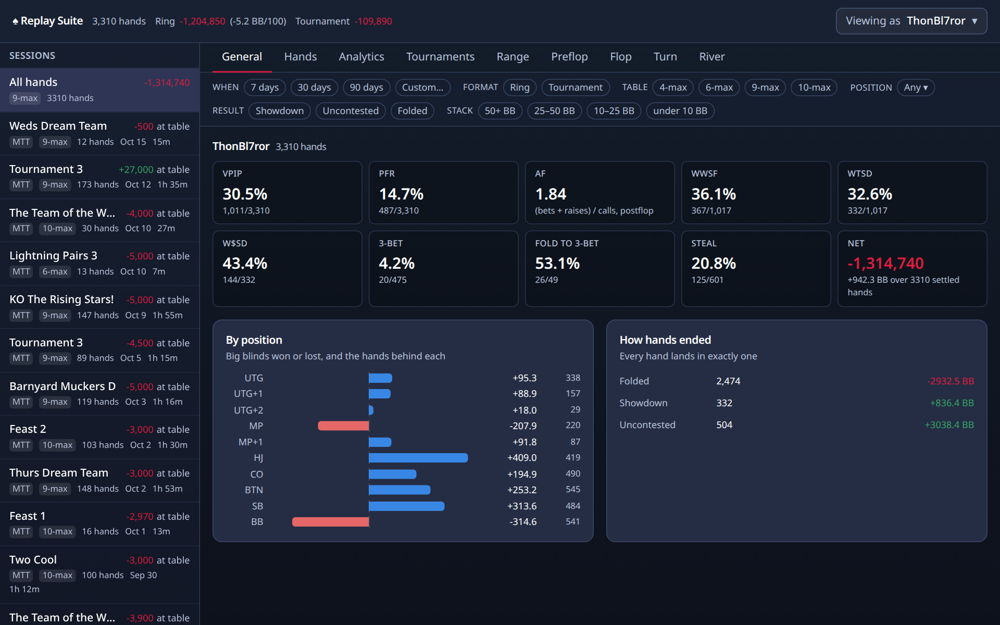
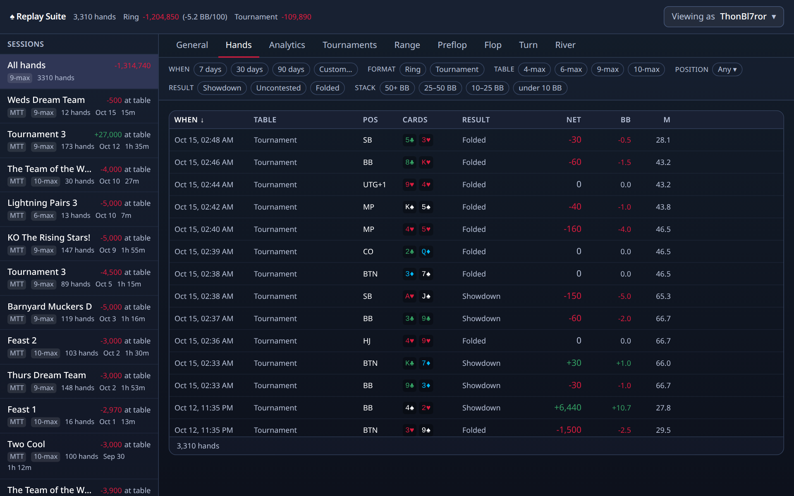
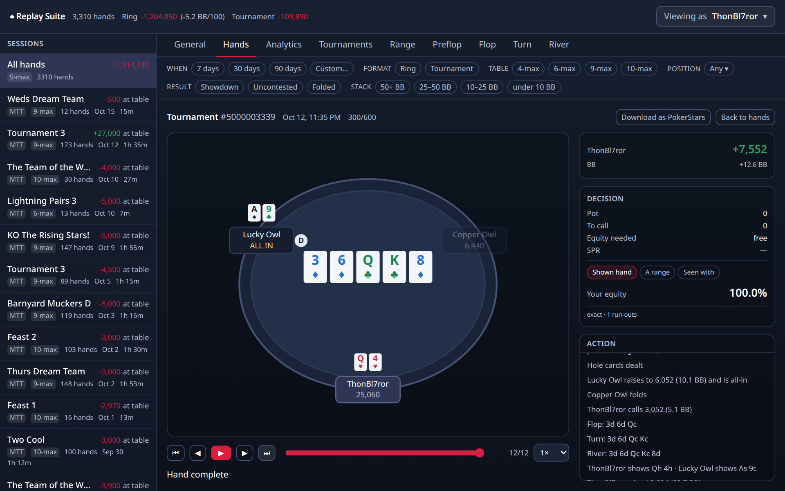
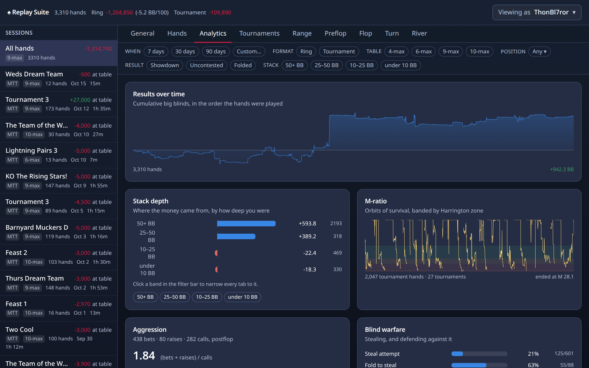
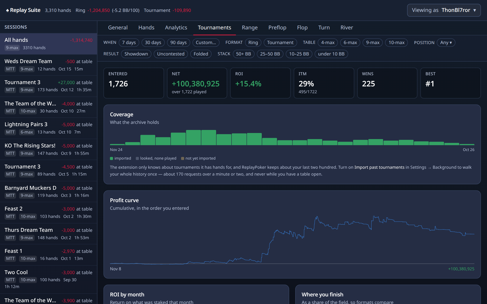
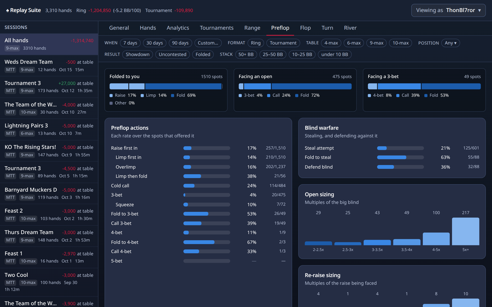
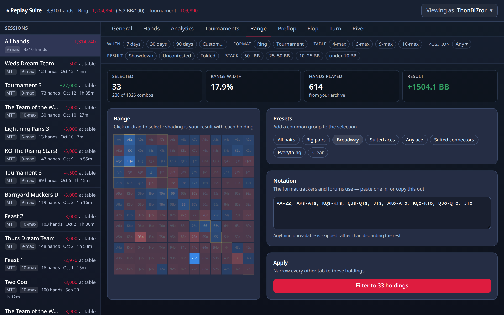
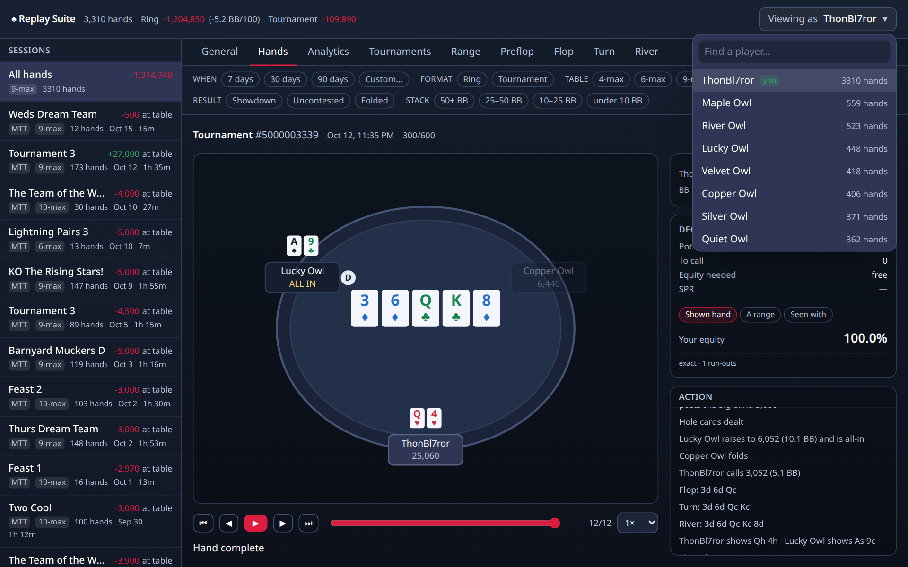

# The dashboard

Click the icon, then <kbd>Open Dashboard</kbd>. Left side: your sessions and tournaments. Top: the tabs. Top right: who you are looking at.

<!-- VIDEO: V4 Deep dive, chapters "Top bar" to "Viewing as" -->

## The top bar

How many hands, and your result. Ring games are shown in chips, tournaments in big blinds, and the two are kept apart on purpose: a chip in a tournament is not a chip in a ring game.

## The sessions list

Every table you have sat at, newest first, with the format (ring, MTT, SnG), the table size, how many hands, and the result. Click one and every tab narrows to it. Click **All hands** to widen again.

## The filter bar

Under the tabs. When (7 days, 30 days, custom), format, table size, position, how the hand ended, and stack depth. Every chip you press narrows every tab at once. Press it again to clear.

## General

The overview. Your headline numbers as cards, your result by position, and how your hands ended.

Every card is a link. Click it and the Hands tab shows the exact hands it was counted from. The filter stays visible up top, greyed on other tabs, so you always know what you are looking at.

!!! coach "Coach's opinion"
    <!-- COACH: Card "What \"by position\" is telling you" -->
    The chart on the General tab shows big blinds won or lost from each seat. Nearly everyone loses from the small blind and the big blind. That is the price of the blinds. You paid before you saw your cards, and you act first on every later street. The useful question is how much. If the blinds lose more than the button wins, the blinds are calling too many raises. The button should be your best seat, because you act last on every street. If it is not, look at your hands from there. Under the gun (UTG) should be close to even or a little positive, because you are supposed to enter only with strong hands.

!!! coach "Coach's opinion"
    <!-- COACH: Card "What BB/100 means and why we use it" -->
    Chips won tells you the result. It does not tell you the rate, and it cannot compare a session at 50/100 blinds with a session at 500/1000. BB/100 fixes that. Take your net in big blinds, divide by the hands, multiply by 100. Now every ring session is on the same scale. A winning Replay player might run 10 to 20 BB/100 over a large sample, because the calls are looser than at a real-money table. Do not read anything from a few hundred hands. The rate swings wildly before a few thousand. It is ring-only, because a tournament's big blind keeps rising, so a rate per 100 hands would mean nothing there.

## Hands

Every hand, newest first. When, which table, your seat, your cards, how it ended, the result in chips and in big blinds, and M (for tournaments).

Sort by clicking a column heading. Narrow with the filter bar. Click a hand to replay it.

!!! coach "Coach's opinion"
    <!-- COACH: Card "Which hands are worth replaying" -->
    Not the big wins. You already know how those went. Replay three kinds of hands. First, the big losses, and ask one question: was there a street where a fold would have saved most of it? Second, the hands where you called on the river and lost, because that is where most chips leave a Replay stack. Third, the medium pots you won without a showdown, because those show you which bets worked. Use the stat filters. Click a stat on any street tab, choose "Only where you took it", and the Hands tab shows exactly those spots. Ten hands chosen that way teach more than a hundred scrolled through.

## The replayer

Steps through one hand like a video. Seats, stacks, the pot and the board, with bets drawn to scale. The action log on the right is the hand in words; click any line to jump there.

**The Decision panel** shows, at every step: the pot, what it costs you to call, the share of the pot you need to win for the call to be worthwhile, and SPR (your stack divided by the pot).

**Equity** appears when there is something honest to compute it from:

- **Shown hand**: the player later showed their cards, so the add-on can tell you your real chances against that hand on the flop and turn, before you knew.
- **A range**: pick a set of hands they might have had, and see your chances against that.
- **Seen with**: your chances against the hands you have actually seen this player show down before. The panel says exactly what it is using.

<kbd>Download as PokerStars</kbd> exports the hand for other poker software.

!!! coach "Coach's opinion"
    <!-- COACH: Card "Pot odds in one minute" -->
    The Decision panel shows four lines. Pot is what is in the middle. To call is what it costs to stay. Equity needed is the share of the time you must win for that call to break even. If the pot is 600 and the call is 200, you put in 200 to win 800, so you need to win one time in four, or 25 percent. Compare that to how often your hand wins. A flush draw on the flop wins about 35 percent by the river, so it clears 25. SPR is the stack divided by the pot. Below 3, you are usually committed with a good pair. Above 10, you can wait.

!!! coach "Coach's opinion"
    <!-- COACH: Card "Equity, and why \"shown hand\" matters" -->
    Equity is your chance of winning the pot if all the cards were dealt out. It only means something against a specific set of opponent cards. The panel offers three ways to fill that in. "Shown hand" uses the cards the opponent turned over at showdown, so it invents nothing. But on the flop you did not know those cards. The panel says "hindsight" for that reason. "A range" is your own guess at what they might hold, and you can see what you assumed. "Seen with" builds a range from what this player has shown in your archive, which is slanted toward strong hands, since weak ones get folded before showdown. Use it with care.

## Analytics

Charts. Each has a short line under it saying what it shows, and each responds to the filter bar.

- **Results over time**: your cumulative result, hand by hand. Hover for the hand behind any point.
- **Stack depth**: where your chips came from, by how deep you were.
- **M-ratio** (tournaments only): how much time you had, in Harrington's colours.
- **Aggression**: bets and raises against calls, after the flop.
- **Starting hands**: which hands made and cost you the most.

!!! coach "Coach's opinion"
    <!-- COACH: Card "Results over time, and variance" -->
    The curve on the Analytics tab is your running total, one point per hand. Look at its shape, not one point. A gentle upward slope with bumps is a winning player having a normal week. A steep drop is usually two or three big pots. Click the point to open the hand. Variance is the word for the swings that happen even when you play well. At Replay, with loose calls and big pots, the swings are larger than at a tight table. A few hundred hands can show a loss for a good player and a win for a poor one. Judge yourself over thousands of hands, and judge each decision in the replayer, not by how it ended.

!!! coach "Coach's opinion"
    <!-- COACH: Card "Stack depth: why the same hand plays differently at 12 BB and 80 BB" -->
    With 12 big blinds, ace-jack is a hand you push all-in with before the flop and never see the flop with. With 80 big blinds, the same hand is a call or a modest raise, and the decisions come after the flop. Small pairs go the other way. At 80 BB they are worth a call to try for a set, because the pot can grow large if you hit. At 12 BB there is no room for that. The Stack depth chart shows your result in four bands, from 50+ BB down to under 10 BB. If one band is bleeding, click it, and every tab narrows to those hands.

!!! coach "Coach's opinion"
    <!-- COACH: Card "M-ratio for tournament players" -->
    M is your stack divided by the cost of one full round of blinds and antes. It answers the only tournament question that matters: how long can I wait? The chart bands it the way Dan Harrington did. Green, above 20, is normal poker. Yellow, 10 to 20, is when you stop calling raises with hands that need a cheap flop. Orange, 6 to 10, is when the raise-and-fold game ends and your main move is all-in first into the pot. Red, under 6, means the next reasonable hand goes in. At Replay, players sit in the yellow and orange far longer than they should, calling and hoping. Watch your own colour and act before it turns.

!!! coach "Coach's opinion"
    <!-- COACH: Card "Aggression factor, what it is and is not" -->
    AF is bets plus raises, divided by calls, after the flop. It is a ratio, not a percentage. A 2.0 means this player bets or raises twice for every call. What it tells you is style: does this player push or follow? What it does not tell you is how often they bet. A player who checks nine times and bets once, never calling, has an AF of infinity and the badge shows 9.9. Read it with the Bet and Chk stats on each street. A low AF, under 1.0, at a Replay table is a calling station. Value bet them and stop bluffing. A high AF with a low VPIP is a player who bets when they have it.

## Tournaments

Each tournament you have played: name, size, buy-in, where you finished, what it paid, and how many hands you played in it. Results come from Replay's own history and settle a few minutes after the tournament ends. This tab is only shown for you, not for other players.

## Preflop, Flop, Turn and River

The detailed numbers, street by street. Each street tab starts with your decisions (first to act, after checking, facing a bet) and then lists every stat with its percentage and the fraction behind it. The Flop tab also breaks down by board texture.

You do not need these to get value from the add-on. When you are curious, every number is a link to its hands, and every stat is one line in the [glossary](glossary.md).

## Range

A grid of all 169 starting hands, coloured by how you play them. Preset ranges on the side; click a hand to see the hands where you held it.

!!! coach "Coach's opinion"
    <!-- COACH: Card "The Range tab: what a 13 by 13 grid shows" -->
    The grid has 169 cells, one for every starting hand that plays the same way. Pairs run down the diagonal from AA to 22. Suited hands sit above it, offsuit hands below. Suited means both cards in one suit. K9s is the cell for a king and a nine of the same suit. Each cell is shaded by how you have done with that hand, blue for won, red for lost, empty for never dealt. Click cells, or drag across them, to build a selection. Range width tells you what share of all possible holdings that is. Then apply it, and every tab shows only hands where you held one of those. Try selecting your red cells and asking why.

## Viewing as

Top right. Pick any player you have shared a table with and the whole dashboard shows their hands, as you saw them. Every tab works the same way, apart from Tournaments, which Replay does not expose for other players.

