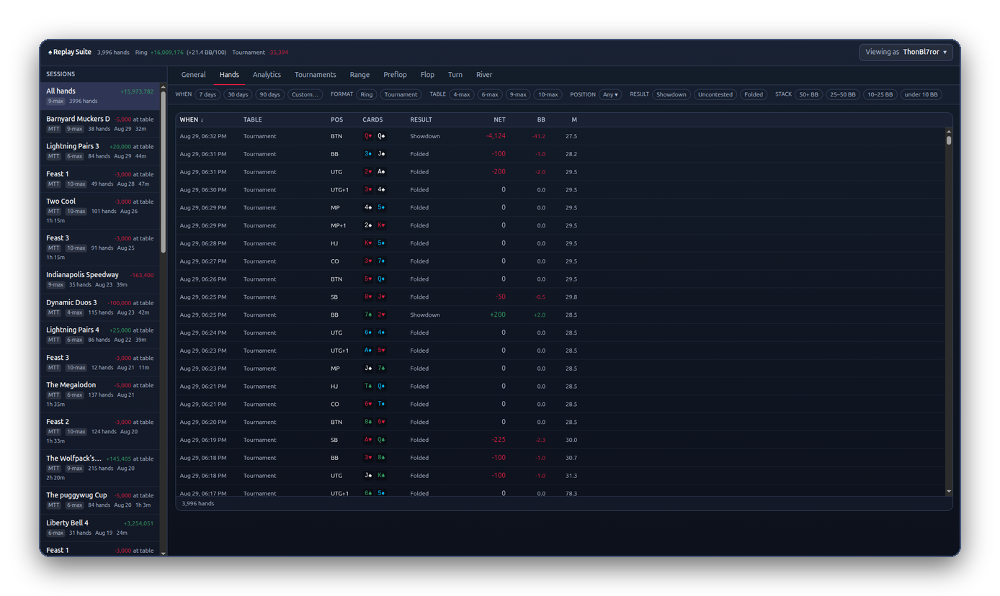

# Your first day

You have installed the add-on. This page is the first ten minutes.

<!-- VIDEO: V4 Deep dive, chapter "First day and importing" -->

## The welcome screen

Go to Replay and click the Replay Suite icon at the top of your browser. The first time, it shows a short welcome with three things worth reading:

1. **Everything stays on this device.** There is no account and no server.
2. **Hand recording is on from the start.** Only hands you are dealt into are saved.
3. **Back up now and then.** Your hands live only here. A backup is one click. [How](data.md#back-up).

<!-- SHOT: popup-first-run.png -->

## Bring in the hands you have already played

The welcome screen asks: *Start with the hands you have already played?*

Say yes. Replay keeps your last 200 hands and your tournament history. The add-on fetches them so you do not start from zero. It does this slowly, in the background, and never while you are sitting at a table. You can watch the progress in the popup.

<!-- SHOT: popup-import-running.png -->

## Play

Sit at a table and play as normal. There is nothing to click. Each hand is saved as it finishes.

A small marker on the table shows that recording is on. If a hand arrives damaged, because of a slow connection or a page reload in the middle of it, the hand is skipped rather than saved wrong, and the marker says so. The add-on fetches skipped hands back from Replay later, when it can.

<!-- SHOT: table-recording-pill.png -->

## Open the dashboard

Click the icon, then <kbd>Open Dashboard</kbd>. Your hands are there. The [dashboard page](dashboard.md) explains each tab.

## About the first week

Numbers about *other* players only appear once you have seen them play enough hands. Until then, the add-on shows a dash, or a small warning that the sample is thin, rather than a guess. A number built on eight hands is worse than no number. Play on. The badges fill in by themselves.

!!! coach "Coach's opinion"
    <!-- COACH: Card "How many hands before you trust a number" -->
    Every stat has its own floor, the smallest sample before the extension will show it at all. VPIP needs about 15 hands. Fold to 3-bet needs 12 times of actually being re-raised after opening, which can take 300 hands to collect. The reliability bar under each stat fills from the floor up, and reads full at several times the floor. An empty bar is a hint. A full bar is a read. Between the two, ask whether the number would surprise you if it moved ten points. If it would, wait. Sample size is the only honest defence against being fooled by a player's last three hands.

!!! try "Try it: two minutes"
    Play three hands. Open the dashboard. Click the newest hand in the Hands tab and press play. That is the whole loop: play, then look.
