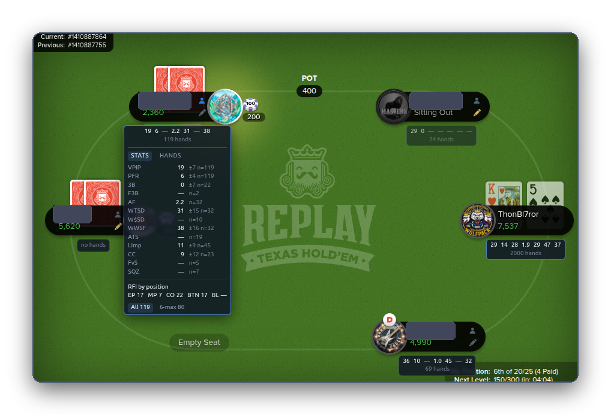

# The HUD

The HUD is the small badge under each player at the table. This page covers switching it on, reading it, and changing what it shows.

<!-- VIDEO: V4 Deep dive, chapters "The HUD" -->

## Switch it on

Settings, HUD, <kbd>Show stats on the table</kbd>. At the table, a badge appears under every player you have history with. No history, no badge.

## Read it

The badge shows a short line of numbers and, underneath, how many hands they are built on. Point your mouse at the badge and it opens into a panel with the names of the stats, the fraction behind each one, and a reliability bar.

By default the badge shows three things: **VPIP**, **PFR** and the hand count.

!!! coach "Coach's opinion"
    <!-- COACH: Card "The three numbers to start with" -->
    The badge shows three things by default: VPIP, PFR and the hand count. Read them in reverse. The hand count first, because it tells you whether to believe the other two. Under 30 hands, treat them as a first impression. VPIP next: how many hands does this player enter? At Replay, 40 is normal. 60 is loose. 20 is tight for these tables. Then PFR: of the hands they play, do they raise or call? A big gap between VPIP and PFR, say 45 and 8, is a caller. A small gap, say 25 and 20, is a raiser. That one comparison tells you more than any other single number on the badge.

### The reliability bar

Under each stat in the open panel. It fills as the sample grows. A short bar means few decisions seen; a full bar means the number is as trustworthy as it is going to get. A dash instead of a number means the sample is below the stat's floor and the add-on would rather say nothing than guess.

!!! coach "Coach's opinion"
    <!-- COACH: Card "How many hands before you trust a number" -->
    Every stat has its own floor, the smallest sample before the extension will show it at all. VPIP needs about 15 hands. Fold to 3-bet needs 12 times of actually being re-raised after opening, which can take 300 hands to collect. The reliability bar under each stat fills from the floor up, and reads full at several times the floor. An empty bar is a hint. A full bar is a read. Between the two, ask whether the number would surprise you if it moved ten points. If it would, wait. Sample size is the only honest defence against being fooled by a player's last three hands.

### The Hands tab in the panel

Next to Stats. The hands you have actually seen this player play, most relevant first, each on one line: their cards if shown, and what they did on each street. A number is never only a number.

### Two examples

!!! coach "Coach's opinion"
    <!-- COACH: Card "Reading a very loose player" -->
    A badge like VPIP 62, PFR 10, WTSD 45 describes a player who enters most pots, mostly by calling, and does not fold once they have seen a flop. Bluffing them is expensive. Value betting them is where your chips come from. Bet your good pairs and better on every street and size those bets larger than you would against anyone else, because they are paying to see your hand. Do not slow-play. They will call anyway. The one thing to respect is a raise from them, especially on the turn or river, because a player who calls everything only raises when they have it. Check their XR and RvCB to confirm.

!!! coach "Coach's opinion"
    <!-- COACH: Card "Reading a very tight player" -->
    A badge like VPIP 14, PFR 11, F3B 75 describes a player who waits for good cards, raises when they get them and lets go when re-raised. Their raise means a real hand, so fold hands you would call with against anyone else. Their fold rate is the opportunity. Raise their blinds from the button. Re-raise their opens when you have position, because F3B 75 says they give up three times in four. After the flop, if they check, bet. They rarely check strong hands. Tight players at Replay are less common than loose ones, and they are often the ones who have been playing a long time. Respect their bets and attack their folds.

## Where the badge sits

- Behind the cards and chips, never on top of them.
- Never where the Fold, Call and Raise buttons are. If there is no clear space, the badge is left out rather than moved onto a button.
- Dimmed until you point at it.
- Your own badge is off by default (your numbers are on the dashboard). Settings, HUD, <kbd>Include your own seat</kbd> turns it on.

## Change what it shows

Settings, HUD. Two layouts, one for 6-max and one for 9- and 10-max, because a full table has less room. Add a stat, choose its row and position, and the live preview on the right shows what the badge will look like. Two or three rows are allowed; the page warns when a badge is getting crowded.

<!-- SHOT: options-hud-builder.png -->

## Colour

Off, the badge is grey. On, a number gets a tint when it is outside a normal range. Two scales to choose from, per badge:

- **Correctness**: green when a number is in a healthy range for you. Meant for your own badge.
- **Exploitability**: highlights how far a player is from the middle, because a player far from it is a target, not a mistake. Meant for other players' badges.

Numbers describe the table you are at: the same seat count, with bounty events kept separate. When there is not enough of that, the badge falls back to your whole history with the player, and says so.

## Which stats can go on the badge

All of them are in the [glossary](glossary.md). The ones most people add after the first three: **3B** (3-bet), **F3B** (fold to 3-bet), **AF** (aggression factor), **WTSD** (went to showdown), **WWSF** (won when saw flop), **Limp**, **ATS** (attempt to steal).
