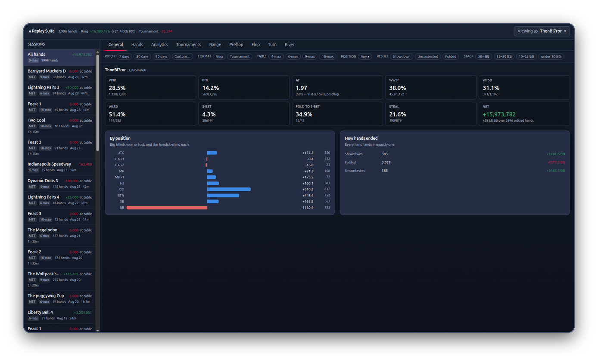

# Replay Suite

Every hand you play on ReplayPoker, saved and explained. On your computer, nowhere else.

Replay Suite is a free add-on for your browser. It records your hands as you play, lets you replay any of them, shows how you are doing, and puts a few numbers about each opponent right at the table. No sign-up. Nothing leaves your computer.

[Firefox: install in one click]({{ amo_url }}){ .md-button .md-button--primary }
[Chrome and Edge: download {{ latest_chrome_version }}]({{ latest_zip_url }}){ .md-button }
[Step-by-step guide](install.md){ .md-button }

Not sure which browser you have? Look at the icon you click to get online. An orange fox is **Firefox**. A red, yellow and green circle is **Chrome**. A blue and green wave is **Edge**. Firefox installs and updates itself; Chrome and Edge are [installed by hand](install.md#chrome) and [updated by hand](updating.md).

## Right now

{{ status_box() }}

## What it does

- **Records every hand** you are dealt into, automatically.
- **Replays any hand**, step by step, with the pot odds worked out.
- **Reads your opponents** with a small badge under each player at the table.
- **Shows how you are doing**, by seat, by tournament, by starting hand.

[See everything it does](what-it-does.md)

## Who made it

Replay Suite is made by **Badr (aka ThonBl7ror)**, a Replay player. It is free to use and will stay free: no premium version, no adverts, and nothing about you leaves your device. Replay staff know about it and have given it the okay. It is not affiliated with ReplayPoker.

If you would like to say thanks, there is a **Support** button in the add-on. Entirely optional.
