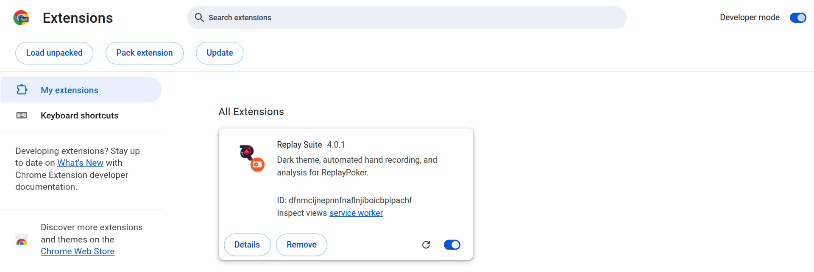

# Install

Replay Suite works in Firefox, Chrome and Edge. Pick your browser below.

<!-- VIDEO: V2 Installation (chapters: Firefox, Chrome, Edge) -->

## Firefox

One click. Firefox is the recommended browser because this is the only store the add-on is in so far.

1. Go to [addons.mozilla.org/en-US/firefox/addon/replay-suite]({{ amo_url }}).
2. Click <kbd>Add to Firefox</kbd>.
3. Firefox asks if you are sure. Click <kbd>Add</kbd>.
4. Go to Replay. A small Replay Suite icon appears at the top right of Firefox.

<!-- SHOT: install-firefox-1.png (AMO page, button highlighted) -->
<!-- SHOT: install-firefox-2.png (permission box) -->
<!-- SHOT: install-firefox-3.png (icon in the toolbar) -->

If the icon is not there, click the extensions button (a puzzle piece) at the top right and pin Replay Suite.

Do not have Firefox? It is free from [mozilla.org/firefox](https://www.mozilla.org/firefox/). Installing it does not remove your other browser.

## Chrome

The Chrome store has not accepted the add-on yet. Chrome runs it fine. You install it by hand, once, and it stays.

1. Download the add-on: [download version {{ latest_chrome_version }}]({{ latest_zip_url }}). The file is called `replay-suite-chrome.zip`.
2. **Unzip it** somewhere you will not delete later. Your Documents folder is a good place.
    - On Windows: right-click the file and choose <kbd>Extract All</kbd>.
    - On a Mac: double-click the file.
3. In Chrome, type `chrome://extensions` in the address bar and press Enter.
4. At the top right, switch on <kbd>Developer mode</kbd>.
5. At the top left, click <kbd>Load unpacked</kbd>, then choose the folder you unzipped.
6. Click the puzzle-piece icon at the top right of Chrome, find **Replay Suite**, and click the pin next to it.

<!-- SHOT: install-chrome-6.png (pin in the puzzle menu) -->

!!! careful "Keep the folder"
    Chrome keeps using the folder you unzipped. If you delete or move it, the add-on stops working. Your hands are safe (they are stored elsewhere) but you would have to install again.

Chrome shows a message every time it starts about "developer mode extensions". That is normal for anything installed this way. Click it away.

## Edge

Same idea as Chrome, slightly different screen.

1. Download the add-on: [download version {{ latest_chrome_version }}]({{ latest_zip_url }}). It is the same `replay-suite-chrome.zip` as for Chrome.
2. **Unzip it** somewhere you will not delete later. Your Documents folder is a good place.
3. In Edge, type `edge://extensions` in the address bar and press Enter.
4. On the left, switch on <kbd>Developer mode</kbd>.
5. At the top, click <kbd>Load unpacked</kbd>, then choose the folder you unzipped.
6. Click the puzzle-piece icon at the top right of Edge, find **Replay Suite**, and click the eye icon so it stays visible.

<!-- SHOT: install-edge-4.png (Developer mode in the left sidebar) -->
<!-- SHOT: install-edge-5.png (Load unpacked) -->

## Did it work?

Go to Replay and click the Replay Suite icon at the top of your browser. If you see a welcome screen, you are done. [Your first day](first-day.md) picks up from there.

If nothing happens, reload the Replay page once. If the icon is missing, look under the puzzle piece (Chrome, Edge) or the extensions button (Firefox) and pin it.

## Updating

- **Firefox** updates the add-on on its own.
- **Chrome and Edge** do not. Your hands stay safe when you update, as long as you follow [the updating steps](updating.md). The short version: back up, unzip the new version over the old folder, click the reload arrow, and never click **Remove**.
